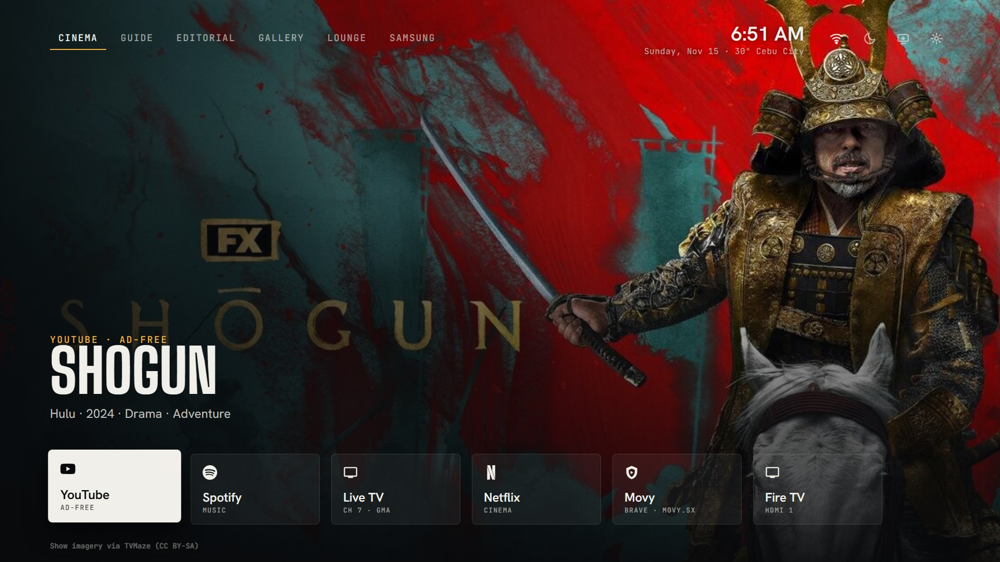
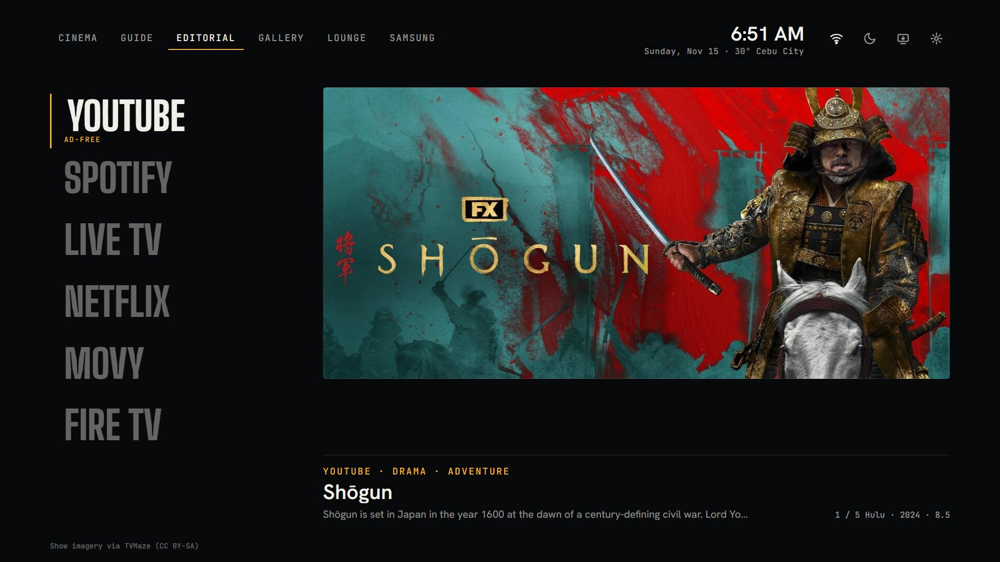
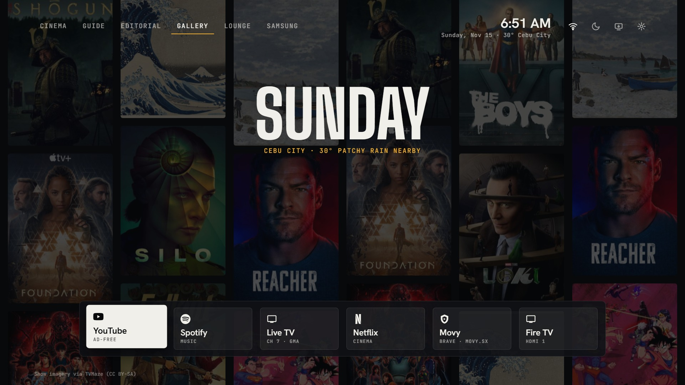
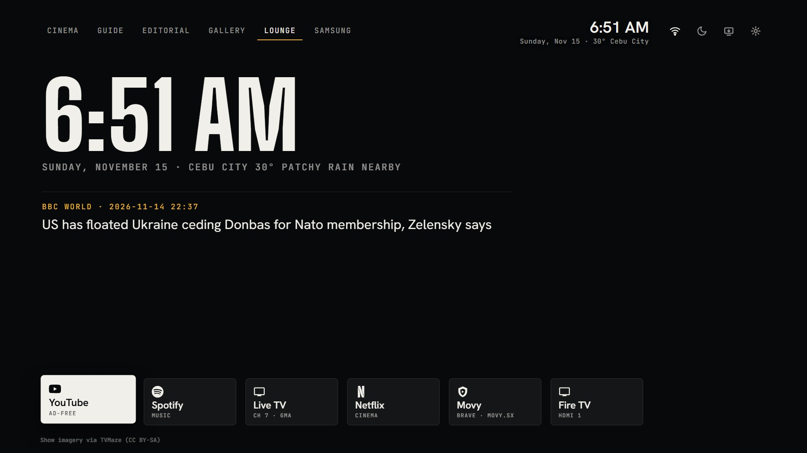

# Clean TV Home for Samsung Tizen TVs

A fast, Swiss-editorial **1920×1080** home screen launcher for **Samsung Tizen Smart TVs** — zero ad banners, zero Samsung TV Plus bloat, hardware terrestrial TV tuner integration, ad-free YouTube (`TizenTube`), 1-click `Movy` (`movy.sx`) free cinema launcher, live weather, and a burn-in-safe ambient briefing mode. Built in plain ES5/CSS with zero frameworks or build step, tuned for rock-solid performance on older TV chipsets (including **Tizen 6.5 / Chromium 85**).

---

## Five Switchable Layouts (Press `1–5` or `Up`)

| View | Key | Layout & Purpose |
|---|---|---|
| **1 · Cinema** | `1` | Full-bleed 1080p backdrop stage with display typography, synopsis, and bottom app dock. |
| **2 · Guide** | `2` | App dock + contextual 4-card shelf (Trending series, Live TV tuner actions, or direct `movy.sx` catalog links). |
| **3 · Editorial** | `3` | Vertical Swiss typographic index on the left paired with a 16:9 preview frame and metadata footer on the right. |
| **4 · Gallery** | `4` | 6-column drifting poster wall behind a frosted center dock with large weekday type and live local weather. |
| **5 · Lounge** | `5` | High-contrast burn-in-safe clock (with subtle pixel shift every minute), live weather, and rotating BBC World briefing headlines. |

### Visual Gallery

| | |
|---|---|
|  |  |
| **1 · Cinema** — Full-bleed stage & dock | **2 · Guide** — App dock & contextual 4-card shelf |
|  |  |
| **3 · Editorial** — Vertical index & showcase frame | **4 · Gallery** — Drifting poster wall & weather |

<p align="center">
  
  <br><strong>5 · Lounge</strong> — Ambient clock, local weather &amp; live BBC World headlines
</p>

---

## Key Features

- **Curated App Dock (`YouTube · Spotify · Live TV · Netflix · Movy`)**:
  - **Ad-Free YouTube (`TizenTube`)**: Automatically prioritizes `tUb3Xq7Lm9.Tube` and hides stock Samsung YouTube (`9Ur5IzDKqV.TizenYouTube`) so you get SponsorBlock, DeArrow, and zero video/home ads.
  - **Live Terrestrial TV (`DTV / Antenna`)**: Integrates directly with `tizen.tvwindow` and `tizen.tvchannel` for full-screen antenna playback, `CH+` / `CH-` channel zapping, `Channel List`, `Broadcast Guide` (EPG), and `Auto Scan`.
  - **Movy Free Cinema (`movy.sx`)**: Rewires Samsung's browser (`org.tizen.browser`) into a **1-click Brave-shield `Movy` launcher** with direct deep links in **Guide** and **Editorial** for **`Movy Featured`** (`/`), **`Movies Catalog`** (`/browse/movie`), **`TV Series`** (`/browse/tv`), and **`Anime Collection`** (`/browse/anime`).
  - **HDMI CEC / Input Tiles**: Automatically surfaces connected or previously seen HDMI devices (e.g., Fire TV, Apple TV, console).
- **Zero-Key Live Data + Offline Resilience**:
  - **No API Key Needed**: Pulls live 1080p show backdrops, ratings, genres, synopses, and cast via **TVMaze** (12h cache), local weather via **ipwho.is + wttr.in** (30m cache), and headlines via **BBC World RSS** (30m cache).
  - **Optional TMDB Key**: Add a free TMDB key in `key.js` to switch artwork to US trending/network catalogs.
  - **Offline Art Fallback**: Bundled **Art Institute of Chicago** public-domain paintings (CC0) ensure instant paint even offline.
- **Architectural Controls & Screensaver**:
  - **Night Dimmer (`0` key or Moon icon)**: Drops screen brightness by 68% at night without leaving Home.
  - **Idle Art Clock**: After **3 minutes** without a keypress, enters a full-screen 300px clock overlay rotating show art every **30 seconds**; any keypress wakes immediately.
  - **1-Click `Samsung` Escape Hatch**: Header button launches `com.samsung.tv.csfs` cleanly whenever you actually want stock Samsung Hub.
- **Native Home-Button Watcher (`TvHome0001.Watcher`)**:
  - Runs at boot (`on-boot="true"`, `auto-restart="true"`) on `127.0.0.1:47791`, polling `127.0.0.1:8001` so pressing the **Home** button inside apps returns you straight to Clean TV Home — while standing aside cleanly when another app or cast is active, or when **Art Mode** is active on **The Frame**.

---

## How to Get Rid of All Ads on `movy.sx`

Samsung Tizen locks web rendering to its built-in browser engine (`org.tizen.browser` / `com.samsung.tv.knox-browser`), which does not run third-party Brave Shields extensions natively. You have **two reliable ways** to remove `movy.sx` ads completely:

### Method 1 — Built-in Official `movy.sx` Toggle (Fastest, Zero Setup)
1. Open **`Movy`** from Clean TV Home (or press **Enter** on **`Movy Featured`**).
2. Click the **Profile icon** in the top-right corner of `movy.sx` *(no account or login required)*.
3. Toggle **"Show ads"** to **OFF** (`sessionStorage["ads-enabled-session"] = "false"`).
4. This disables both third-party ad scripts (`vidy.st` & `doomsarchaic.com`) inside that browser session while keeping `movy.sx`'s HTML5/HLS player working normally.

### Method 2 — System-Wide AdGuard DNS (Permanent Blocking Across Sites)
> **Note:** Samsung Tizen OS restricts third-party `.wgt` apps from overwriting OS network settings (`IP Settings / DNS Setting`), so DNS cannot be edited automatically by an app script. Set it once in 20 seconds:
1. Click the **Settings (gear)** icon in the top-right corner of Clean TV Home.
2. Go to **General → Network → Network Status → IP Settings → DNS Setting → Enter manually**.
3. Enter **`94.140.14.14`** (AdGuard DNS) and save *(or configure AdGuard DNS on your home router so every TV and phone gets ad blocking automatically)*.

---

## Supported TVs

| Status | Model / Series | Tizen / Engine | Notes |
|---|---|---|---|
| **Verified** | **Samsung BU8100 55"** (`UA55BU8100GXXP`, 2022) | **Tizen 6.5 (Chromium 85)** | Full verification over CDP & live terrestrial antenna + `TizenTube` + `Movy` |
| **Verified** | **Samsung CU7000 65"** (`UN65CU7000DXZA`, 2023) | **Tizen 8.0** | Upstream hardware target |
| **Compatible** | **Samsung Smart TVs (2018–2025)** | **Tizen 4.0 – 8.0+** | Crystal UHD (`NU`/`RU`/`TU`/`AU`/`BU`/`CU`/`DU`), QLED, Neo QLED, OLED |
| **Compatible** | **Samsung The Frame** | **Tizen 5.0 – 8.0+** | Includes dedicated Art Mode guard (`app/service/artmode.js`) so booting/Art Mode is never interrupted |

*Why it runs fast even on budget TVs:* fixed `1920×1080` canvas avoiding modern CSS features unsupported on Chromium 85 (`inset`, `aspect-ratio`, flex `gap`), GPU-only `transform`/`opacity` transitions (`<= 180ms`), and debounced backdrop preloading (`80ms`).

---

## Do's and Don'ts

### DO
- **Do wait 3–5 seconds after a cold power-on**: Tizen launches stock Smart Hub first while `TvHome0001.Watcher` initializes (`BOOT_DELAY` = 3s) and automatically brings **Clean TV Home** to the front.
- **Do turn Developer Mode OFF after installation** *(optional)*: Your installed `.wgt` apps (`Clean TV Home` and `TizenTube`) remain signed and functional after toggling Developer Mode off. Only turn it back on when installing updates or new `.wgt` apps.
- **Do install `TizenTube` (`tUb3Xq7Lm9.Tube`)** for ad-free YouTube (available in Releases or via `apps2samsung`); Clean TV Home hides stock YouTube automatically when detected.
- **Do use number keys `1–5` and `0`** on your remote for instant layout switching and Night Dimmer.
- **Do use the top-right `Samsung` button** whenever you need stock Tizen menus, app store downloads, or picture mode tweaks.

### DON'T
- **Don't run Factory Reset / Smart Hub Reset** unless you intend to re-sideload — resetting removes sideloaded `.wgt` apps and Partner signing certificates.
- **Don't install multiple Home-button watcher launchers simultaneously** (e.g., running both `AeroTizen` and `Clean TV Home`); two services polling port `8001` will conflict when pressing Home.
- **Don't expect a `.wgt` app to modify OS DNS (`94.140.14.14`) automatically** — Tizen sandboxes system network configuration to Samsung's built-in Settings app.
- **Don't commit `app/js/key.js` or `dist/`** if you add a personal TMDB API key (both are git-ignored by default).
- **Don't use Tizen 3.0 or older (pre-2018)** or **non-Tizen Samsung monitors/TVs (Orsay)** — those platforms lack modern ES5/Chromium WebView and port `8001` app controls.

---

## Remote Control Shortcuts

| Remote Button | Action |
|---|---|
| `Left` / `Right` / `Up` / `Down` | Navigate views (`row 0`), apps (`row 1`), and shelf cards (`row 2`) |
| `Enter` | Launch focused app, switch TV/HDMI input, open `movy.sx` card, or toggle header control |
| `Back` | Exit fullscreen TV/HDMI window back to Home, or jump focus back to the app dock |
| `1` – `5` | Jump directly to **Cinema (`1`)**, **Guide (`2`)**, **Editorial (`3`)**, **Gallery (`4`)**, **Lounge (`5`)** |
| `0` | Toggle **Night Dimmer** (`68%` dark overlay) |
| `CH+` / `CH-` | Tune terrestrial TV channels up/down (switches directly to Live TV if on Home) |
| `Channel List` | Open Samsung Terrestrial Channel Directory (`org.tizen.channel-list`) |
| `Guide` | Open Broadcast Program Guide EPG (`com.samsung.tv.coba.epg`) |
| `Info` *(in Live TV)* | Show current channel banner (`Ch X · Station`) |
| `Home` | Return immediately to Clean TV Home (handled by `TvHome0001.Watcher`) |

---

## Installation

### Prerequisites
1. On your Samsung TV, open **Apps** → press **`1 2 3 4 5`** on the remote → enable **Developer Mode** and enter your PC's local IP address → reboot the TV (hold Power until Samsung logo appears).
2. Download **[apps2samsung](https://github.com/OneLiberty/apps2samsung)** (Windows/macOS/Linux Partner certificate signer & installer) **or** [AeroTizen CLI](https://github.com/helalaou/AeroTizen).
3. Grab the pre-built **`tv-home.wgt`** (and optionally **`tizen-youtube-tizen-5.5.wgt`** for ad-free YouTube) from [Releases](../../releases), **or** build from source below.

### Option A — Build & Install on Windows (PowerShell)
```powershell
git clone https://github.com/Realwaan/clean-tv-home.git
cd clean-tv-home
# Optional: create Partner cert once via apps2samsung-cli.exe cert --prepare --tv <TV_IP>
.\tools\install.ps1 -TvIp 192.168.254.113
```

### Option B — Build & Install on Linux / macOS
```sh
git clone https://github.com/Realwaan/clean-tv-home.git
cd clean-tv-home
aerotizen --tv <TV_IP> certs
# Optional TMDB API key (otherwise uses keyless TVMaze live show art):
# echo YOUR_TMDB_KEY > ~/.config/tv-home/tmdb.key
./tools/install.sh <TV_IP>
```

---

## PC Remote, Screen Cast & Power Off (`remote/`)

Control your Samsung TV directly from your PC browser — with zero external npm dependencies:

```sh
cd remote
node server.mjs --tv 192.168.254.113
# Or on Windows: double-click remote\start-remote.bat or remote\cast_tv.bat
```

* **PC Remote (`http://localhost:5050`)**: Full virtual remote with Power toggle, D-Pad, Volume/Channel rockers, 1–5 layout jumpers, app shortcuts, and keyboard control (`Arrow Keys`, `Enter`, `Esc`, `H`, `M`, `1–5`).
  * *First-time pairing:* Make sure TV **Settings → General → External Device Manager → Device Connection Manager → Access Notification** is set to **First Time Only** (not Off), then press **Allow** once on your TV screen; the pairing token saves locally to `remote/tv_token.txt`.
* **PC-to-TV Screen Cast (`http://localhost:5050/cast.html`)**:
  * **LAN Screen Cast (Ethernet & Wi-Fi):** Share your entire PC screen, window, or browser tab with audio via `WebRTC` (with automatic `MSE WebM` fallback for Chromium 85) and auto-launch the TV browser receiver (`http://<PC_LAN_IP>:5050/tv-cast.html`).
  * **Native Windows Wireless Display (`Win + K` / Miracast):** 1-click shortcut to open Windows' Cast flyout when Wi-Fi Direct is available.
* **1-Command Power Off**: `node remote/turn_off_tv.mjs <TV_IP>` sends `KEY_POWER` cleanly over `wss://<TV_IP>:8002`.

---

## Project Architecture & Privacy

```text
clean-tv-home/
├── app/
│   ├── config.xml          # Tizen widget manifest, partner privileges & on-boot watcher service
│   ├── index.html          # Single 1920x1080 shell (styles, views, scripts)
│   ├── css/home.css        # Swiss-editorial design tokens & Chromium 85 safe layout rules
│   ├── art/                # 11 bundled CC0 paintings from Art Institute of Chicago (offline fallback)
│   ├── fonts/              # Self-hosted WOFF2 (Big Shoulders Display, Hanken Grotesk, JetBrains Mono)
│   ├── js/
│   │   ├── env.js          # Hardware key registration, localStorage, clock & toast helpers
│   │   ├── system.js       # App filtering, TizenTube prioritization, Movy URL launcher, Live TV/HDMI tuner
│   │   ├── art.js          # TVMaze live show art (keyless), optional TMDB client, MOVY_CARDS & TV_CARDS
│   │   ├── feeds.js        # Local weather (ipwho.is + wttr.in) & BBC World RSS briefing
│   │   ├── logos.js        # Vector brand paths (YouTube, Spotify, Netflix, Brave shield, TV, system icons)
│   │   ├── styles.js       # 5 layout engines (cinema, guide, editorial, gallery, lounge)
│   │   └── main.js         # State machine, navigation, 3-minute idle screensaver & background refresh
│   └── service/            # TvHome0001.Watcher Node service (127.0.0.1:47791 + Art Mode guard)
├── remote/
│   ├── server.mjs          # Zero-dependency remote proxy + RFC 6455 WebSocket cast hub
│   ├── turn_off_tv.mjs     # CLI power-off script over wss://:8002
│   ├── start-remote.bat    # Windows 1-click remote launcher
│   ├── cast_tv.bat         # Windows 1-click PC screen cast launcher
│   └── public/             # Remote UI (index.html), PC Cast Studio (cast.html), TV Receiver (tv-cast.html)
└── tools/
    ├── install.ps1         # Windows packaging & apps2samsung installer
    ├── install.sh          # POSIX packaging & AeroTizen installer
    ├── screens.cjs         # Headless Playwright verification & screenshot script (all 5 styles)
    └── tv-check.mjs        # On-TV CDP performance/FPS/error audit script
```

**Privacy guarantee:** Zero telemetry, zero analytics, zero user accounts. Only read-only public requests leave the TV (`api.tvmaze.com`, `ipwho.is`, `wttr.in`, `api.rss2json.com`, or optionally `api.themoviedb.org` if you configure your own key). The Home-button watcher communicates strictly over loopback (`127.0.0.1`).

---

## Verification & Diagnostics

```sh
# Desktop verification across all 5 styles (1920x1080, zero errors):
node tools/screens.cjs <path-to-playwright> ./out

# On-TV live performance check (with aerotizen inspector forwarded to localhost:9222):
aerotizen --tv <TV_IP> inspect TvHome0001.Home
node tools/tv-check.mjs ./out
```

---

## License & Credits

Licensed under the **[MIT License](LICENSE)**.

- **Clean TV Home (Upstream Base)** — Originally created by **Sai Krishna Madavarapu** (`MIT`).
- **Home-Button Watcher Service (`app/service/`)** — Adapted from **[AeroTizen](https://github.com/helalaou/AeroTizen) 2.5.0** by **Hamza El Alaoui** (`MIT`, see `app/service/LICENSE-AeroTizen`).
- **Ad-Free YouTube (`TizenTube`)** — Companion `.wgt` (`tUb3Xq7Lm9.Tube`) by **reisxd / TizenTube** contributors.
- **Typography** — *Big Shoulders Display*, *Hanken Grotesk*, *JetBrains Mono* (`SIL Open Font License`).
- **Icons** — Brand paths from Simple Icons (`CC0-1.0`) & Material Design Icons (`Apache-2.0`). Brand marks remain trademarks of their respective owners.
- **Artwork & Metadata** — **TVMaze** (`CC BY-SA`), **Art Institute of Chicago** (`CC0`), and optional **TMDB** (`api.themoviedb.org`). This project is not endorsed or certified by Samsung, YouTube, Netflix, Spotify, Movy, or TMDB.
