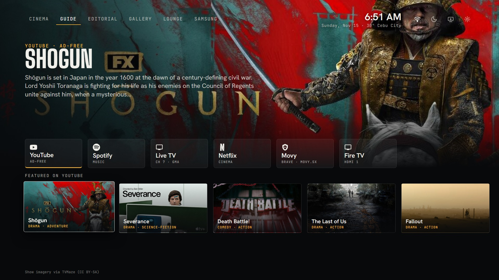

# Clean TV Home — For Samsung Tizen & LG Smart TVs

A fast, Swiss-editorial **1920×1080** home screen launcher and universal PC remote/cast suite for **Samsung Tizen Smart TVs (2018–2025)** and **all LG Smart TVs (webOS 1.0–25 & NetCast)** — zero ad banners, zero home-screen bloat, native Live TV & HDMI integration, ad-free YouTube (`TizenTube` / `YouTube AdFree`), 1-click `Movy` (`movy.sx`) free cinema launcher, live weather, and a burn-in-safe ambient briefing mode. Built in strict ES5 + literal CSS (Chromium 34+ safe) with zero frameworks or build dependencies.

---

## Five Switchable Layouts (Press `1–5` or `Up`)

| View | Key | Layout & Purpose |
|---|---|---|
| **1 · Cinema** | `1` | Full-bleed 1080p backdrop stage with display typography, synopsis, and bottom app dock. |
| **2 · Guide** | `2` | App dock + contextual 4-card shelf (Trending series, Live TV tuner actions, or direct `movy.sx` catalog links). |
| **3 · Editorial** | `3` | Vertical Swiss typographic index on the left paired with a 16:9 preview frame and metadata footer on the right. |
| **4 · Gallery** | `4` | 6-column drifting poster wall behind a frosted center dock with large weekday type and live local weather. |
| **5 · Lounge** | `5` | High-contrast burn-in-safe clock (with subtle pixel shift every minute), live weather, and rotating BBC World briefing headlines. |

### Visual Gallery

| | |
|---|---|
|  |  |
| **1 · Cinema** — Full-bleed stage & dock | **2 · Guide** — App dock & contextual 4-card shelf |
|  |  |
| **3 · Editorial** — Vertical index & showcase frame | **4 · Gallery** — Drifting poster wall & weather |

<p align="center">
  
  <br><strong>5 · Lounge</strong> — Ambient clock, local weather &amp; live BBC World headlines
</p>

---

## Key Features

- **Curated App Dock (`YouTube · Spotify · Live TV · Netflix · Movy`)**:
  - **Ad-Free YouTube (`TizenTube`)**: Automatically prioritizes `tUb3Xq7Lm9.Tube` and hides stock Samsung YouTube (`9Ur5IzDKqV.TizenYouTube`) so you get SponsorBlock, DeArrow, and zero video/home ads.
  - **Live Terrestrial TV (`DTV / Antenna`)**: Integrates directly with `tizen.tvwindow` and `tizen.tvchannel` for full-screen antenna playback, `CH+` / `CH-` channel zapping, `Channel List`, `Broadcast Guide` (EPG), and `Auto Scan`.
  - **Movy Free Cinema (`movy.sx`)**: Rewires Samsung's browser (`org.tizen.browser`) into a **1-click Brave-shield `Movy` launcher** with direct deep links in **Guide** and **Editorial** for **`Movy Featured`** (`/`), **`Movies Catalog`** (`/browse/movie`), **`TV Series`** (`/browse/tv`), and **`Anime Collection`** (`/browse/anime`).
  - **HDMI CEC / Input Tiles**: Automatically surfaces connected or previously seen HDMI devices (e.g., Fire TV, Apple TV, console).
- **Zero-Key Live Data + Offline Resilience**:
  - **No API Key Needed**: Pulls live 1080p show backdrops, ratings, genres, synopses, and cast via **TVMaze** (12h cache), local weather via **ipwho.is + wttr.in** (30m cache), and headlines via **BBC World RSS** (30m cache).
  - **Optional TMDB Key**: Add a free TMDB key in `key.js` to switch artwork to US trending/network catalogs.
  - **Offline Art Fallback**: Bundled **Art Institute of Chicago** public-domain paintings (CC0) ensure instant paint even offline.
- **Architectural Controls & Screensaver**:
  - **Night Dimmer (`0` key or Moon icon)**: Drops screen brightness by 68% at night without leaving Home.
  - **Idle Art Clock**: After **3 minutes** without a keypress, enters a full-screen 300px clock overlay rotating show art every **30 seconds**; any keypress wakes immediately.
  - **1-Click `Samsung` Escape Hatch**: Header button launches `com.samsung.tv.csfs` cleanly whenever you actually want stock Samsung Hub.
- **Native Home-Button Watcher (`TvHome0001.Watcher`)**:
  - Runs at boot (`on-boot="true"`, `auto-restart="true"`) on `127.0.0.1:47791`, polling `127.0.0.1:8001` so pressing the **Home** button inside apps returns you straight to Clean TV Home — while standing aside cleanly when another app or cast is active, or when **Art Mode** is active on **The Frame**.

---

## How to Get Rid of All Ads on `movy.sx`

Samsung Tizen locks web rendering to its built-in browser engine (`org.tizen.browser` / `com.samsung.tv.knox-browser`), which does not run third-party Brave Shields extensions natively. You have **two reliable ways** to remove `movy.sx` ads completely:

### Method 1 — Built-in Official `movy.sx` Toggle (Fastest, Zero Setup)
1. Open **`Movy`** from Clean TV Home (or press **Enter** on **`Movy Featured`**).
2. Click the **Profile icon** in the top-right corner of `movy.sx` *(no account or login required)*.
3. Toggle **"Show ads"** to **OFF** (`sessionStorage["ads-enabled-session"] = "false"`).
4. This disables both third-party ad scripts (`vidy.st` & `doomsarchaic.com`) inside that browser session while keeping `movy.sx`'s HTML5/HLS player working normally.

### Method 2 — System-Wide AdGuard DNS (Permanent Blocking Across Sites)
> **Note:** Samsung Tizen OS restricts third-party `.wgt` apps from overwriting OS network settings (`IP Settings / DNS Setting`), so DNS cannot be edited automatically by an app script. Set it once in 20 seconds:
1. Click the **Settings (gear)** icon in the top-right corner of Clean TV Home.
2. Go to **General → Network → Network Status → IP Settings → DNS Setting → Enter manually**.
3. Enter **`94.140.14.14`** (AdGuard DNS) and save *(or configure AdGuard DNS on your home router so every TV and phone gets ad blocking automatically)*.

---

## Supported TVs

| Status | Brand / Series | OS / Engine | What Works |
|---|---|---|---|
| **Verified** | **Samsung BU8100 55"** (`UA55BU8100GXXP`, 2022) | **Tizen 6.5 (Chromium 85)** | Full launcher (`.wgt`), CDP, live tuner, `TizenTube`, `Movy`, PC Remote, LAN/Miracast Cast |
| **Verified** | **Samsung CU7000 65"** (`UN65CU7000DXZA`, 2023) | **Tizen 8.0** | Upstream hardware target (`.wgt` + PC Remote + Cast) |
| **Compatible** | **Samsung Smart TVs (2018–2025)** | **Tizen 4.0 – 8.0+** | Crystal UHD (`NU`/`RU`/`TU`/`AU`/`BU`/`CU`/`DU`), QLED, Neo QLED, OLED, **The Frame** (with Art Mode guard) |
| **Compatible** | **All LG webOS Smart TVs (2014–2025+)** | **webOS 1.0 – 25 (Chromium 34–120)** | `.ipk` launcher (`org.cleantv.home`), Magic Remote pointer + wheel, unrooted & Homebrew support, `YouTube AdFree`, `SSAP` PC Remote (`3001`/`3000`), 1-click Screen Cast |
| **PC Remote Only** | **Legacy LG NetCast Smart TVs (2011–2013)** | **LG NetCast (`ROAP` `:8080`)** | **PC Web Remote**, **Scan Wi-Fi / LAN**, **6-digit PIN pairing**, and **CLI Power-Off** (manual browser/Miracast casting) |

*Why it runs fast even on older LG webOS 1–3 & budget Samsung TVs:* fixed `1920×1080` canvas avoiding CSS custom properties (`var(--...)`), `inset`, `aspect-ratio`, and flex `gap`; strict ES5 (`var`, `function`) JS; GPU-only `transform`/`opacity` transitions (`<= 180ms`); and debounced backdrop preloading (`80ms`).

---

## Do's and Don'ts

### DO
- **Do wait 3–5 seconds after a cold power-on (Samsung)**: Tizen launches stock Smart Hub first while `TvHome0001.Watcher` initializes (`BOOT_DELAY` = 3s) and brings **Clean TV Home** to the front automatically.
- **Do assign Clean TV Home to a Quick Access key on LG (`Hold 1`)**: On unrooted LG webOS TVs, open Clean TV Home once, then **hold number `1` on your LG remote** to bind 1-press launch — or enable **Homebrew Channel Autostart** if rooted.
- **Do turn Developer Mode OFF after installation on Samsung** *(optional)*: Your installed `.wgt` apps remain signed and functional after toggling Developer Mode off. *(Note: LG Developer Mode requires renewing/toggling the Dev Mode timer periodically unless using Homebrew Channel.)*
- **Do install `TizenTube` (Samsung) or `YouTube AdFree` (LG)** for ad-free YouTube; Clean TV Home automatically targets `tUb3Xq7Lm9.Tube` on Tizen and `youtube.leanback.v4` on webOS.
- **Do use number keys `1–5` and `0` (plus LG Magic Remote pointer & scroll wheel)** for instant layout switching and Night Dimmer.
- **Do use the top-right `Samsung` / `LG Home` button** whenever you need stock TV menus, picture settings, or app store downloads.

### DON'T
- **Don't run Factory Reset / Smart Hub Reset** unless you intend to re-sideload — resetting removes sideloaded `.wgt`/`.ipk` apps and certificates.
- **Don't install multiple Home-button watcher launchers simultaneously on Samsung** (e.g., running both `AeroTizen` and `Clean TV Home`).
- **Don't use Tizen 3.0 or older (pre-2018 Samsung / Orsay)** for `.wgt` sideloading — port `8001` watcher APIs are unavailable there.
- **Don't commit `app/js/key.js`, `tv_token.txt`, `tv_tokens.json`, `tv_config.json`, or `dist/`** (all are git-ignored by default).

---

## Remote Control Shortcuts

| Remote Button | Action |
|---|---|
| `Left` / `Right` / `Up` / `Down` | Navigate views (`row 0`), apps (`row 1`), and shelf cards (`row 2`) |
| `Enter` | Launch focused app, switch TV/HDMI input, open `movy.sx` card, or toggle header control |
| `Back` | Exit fullscreen TV/HDMI window back to Home, or jump focus back to the app dock |
| `1` – `5` | Jump directly to **Cinema (`1`)**, **Guide (`2`)**, **Editorial (`3`)**, **Gallery (`4`)**, **Lounge (`5`)** |
| `0` | Toggle **Night Dimmer** (`68%` dark overlay) |
| `CH+` / `CH-` | Tune terrestrial TV channels up/down (switches directly to Live TV if on Home) |
| `Channel List` | Open Samsung Terrestrial Channel Directory (`org.tizen.channel-list`) |
| `Guide` | Open Broadcast Program Guide EPG (`com.samsung.tv.coba.epg`) |
| `Info` *(in Live TV)* | Show current channel banner (`Ch X · Station`) |
| `Home` | Return immediately to Clean TV Home (handled by `TvHome0001.Watcher` on Tizen; Hold `1` / Autostart on webOS) |
| `Pointer / Wheel` *(LG)* | LG Magic Remote hover focus, click-to-launch, and scroll-wheel browsing across all 5 views |

---

## Installation — Samsung Tizen TVs (`.wgt`)

### Prerequisites
1. On your Samsung TV, open **Apps** → press **`1 2 3 4 5`** on the remote → enable **Developer Mode** and enter your PC's local IP address → reboot the TV (hold Power until Samsung logo appears).
2. Download **[apps2samsung](https://github.com/OneLiberty/apps2samsung)** (Windows/macOS/Linux Partner certificate signer & installer) **or** [AeroTizen CLI](https://github.com/helalaou/AeroTizen).
3. Grab **`tv-home.wgt`** (and optionally **`tizen-youtube-tizen-5.5.wgt`** for ad-free YouTube) from [Releases](../../releases), **or** build from source below.

### Option A — Build & Install on Windows (PowerShell)
```powershell
git clone https://github.com/Realwaan/clean-tv-home.git
cd clean-tv-home
# Optional: create Partner cert once via apps2samsung-cli.exe cert --prepare --tv <TV_IP>
.\tools\install.ps1 -TvIp 192.168.254.113
```

### Option B — Build & Install on Linux / macOS
```sh
git clone https://github.com/Realwaan/clean-tv-home.git
cd clean-tv-home
aerotizen --tv <TV_IP> certs
# Optional TMDB API key (otherwise uses keyless TVMaze live show art):
# echo YOUR_TMDB_KEY > ~/.config/tv-home/tmdb.key
./tools/install.sh <TV_IP>
```

---

## Installation — LG webOS TVs (`.ipk`, 2014–2025+)

1. Grab **`org.cleantv.home_0.2.0_all.ipk`** from [Releases](../../releases) **or** build it with zero external dependencies using `node tools/package-lg.mjs` (or `.\tools\install-lg.ps1` / `./tools/install-lg.sh`).
2. **Method A — GUI via [webOS Dev Manager](https://github.com/webosbrew/dev-manager-desktop) (Easiest, Windows/macOS/Linux):**
   - Install **Developer Mode** from the LG Content Store on your TV, sign in, and turn **Dev Mode Status** ON (or install via **Homebrew Channel** if rooted).
   - Connect your TV in **webOS Dev Manager**, click **Install** (or drag & drop `org.cleantv.home_0.2.0_all.ipk`), then launch **Clean TV Home**.
3. **Method B — CLI via `@webos-tools/cli`:**
   ```sh
   ares-install -d <lg-device-name> dist/org.cleantv.home_0.2.0_all.ipk
   ares-launch  -d <lg-device-name> org.cleantv.home
   ```
4. **Optional Ad-Free YouTube (`YouTube AdFree`) & Autostart on LG:**
   - Install **YouTube AdFree (`youtube-webos`)** right inside **webOS Dev Manager → Apps** (uninstall stock YouTube first). Clean TV Home launches `youtube.leanback.v4` directly.
   - **Quick Access shortcut (unrooted LG):** With Clean TV Home open, **hold `1` on your LG remote** to bind it to Quick Access, or enable **Autostart** in **webOS Homebrew Channel** if rooted.

---

## Universal PC Remote, Screen Cast & Power Off (`remote/`)

Control **Samsung Tizen**, **LG webOS (2014–2025+)**, and **LG NetCast (2011–2013)** TVs directly from your PC browser — with zero external npm dependencies:

```sh
cd remote
node server.mjs --tv <TV_IP> --brand auto
# Or override explicitly: --brand samsung | lg-webos | lg-netcast
# Or on Windows: double-click remote\start-remote.bat or remote\cast_tv.bat
```

* **PC Remote (`http://localhost:5050`)**: Virtual remote with Power / Wake-on-LAN toggle, D-Pad, Volume/Channel rockers, 1–5 layout jumpers, cross-platform app shortcuts (`Clean TV`, `YouTube`, `Spotify`, `Live TV`, `Netflix`, `Movy`), and PC keyboard control (`Arrow Keys`, `Enter`, `Esc`, `H`, `M`, `1–5`).
  * **Switch TV & Scan Wi-Fi / LAN:** Click the TV name at the top of the Remote (`▾ Switch TV`) to enter any IP or click **Scan Wi-Fi / LAN** to auto-discover Samsung & LG TVs.
  * **First-time pairing:**
    * **Samsung Tizen:** Ensure **Device Connection Manager → Access Notification** is **First Time Only** (not Off), then press **Allow** once on your TV.
    * **LG webOS (1.0–25):** Works automatically over `wss://:3001` or `ws://:3000` (unsigned manifest avoids `403 blacklisted certificate`); press **Allow** once on the LG TV popup.
    * **LG NetCast (2011–2013):** Displays a **6-digit PIN** on the TV (`:8080` ROAP) — enter it into the PIN bar inside the PC Remote once.
  * Pairing keys persist privately per TV IP in `remote/tv_tokens.json` (plus `remote/tv_token.txt`).
* **PC-to-TV Screen Cast (`http://localhost:5050/cast.html`)**:
  * **LAN Screen Cast (Ethernet & Wi-Fi):** Share your entire PC screen, window, or browser tab with audio via `WebRTC` (with automatic `MSE WebM` fallback for older TV browsers) and auto-launch the receiver (`http://<PC_LAN_IP>:5050/tv-cast.html`) on **Samsung Tizen** or **LG webOS** TVs.
  * **Native Windows Wireless Display (`Win + K` / Miracast):** 1-click shortcut to open Windows' Cast flyout when Wi-Fi Direct is available.
* **1-Command CLI Power Off**: `node remote/turn_off_tv.mjs --tv <TV_IP>` (auto-detects Samsung Tizen, LG webOS, or LG NetCast).

---

## Project Architecture & Privacy

```text
clean-tv-home/
├── app/
│   ├── appinfo.json        # LG webOS widget manifest (org.cleantv.home) + icon80.png / icon130.png
│   ├── config.xml          # Samsung Tizen widget manifest, partner privileges & watcher service
│   ├── index.html          # Shared 1920x1080 shell (styles, views, scripts)
│   ├── css/home.css        # Swiss-editorial literal CSS (Chromium 34+ / webOS 1-25 & Tizen 4-8 safe)
│   ├── art/                # 11 bundled CC0 paintings from Art Institute of Chicago (offline fallback)
│   ├── fonts/              # Self-hosted WOFF2 (Big Shoulders Display, Hanken Grotesk, JetBrains Mono)
│   ├── js/
│   │   ├── env.js          # Dual platform detection (Tizen + webOS PalmServiceBridge), LG/Samsung keys
│   │   ├── system.js       # Cross-platform app discovery, YouTube AdFree/TizenTube, Movy, Live TV/HDMI
│   │   ├── art.js          # TVMaze live show art (keyless), optional TMDB client, MOVY_CARDS & TV_CARDS
│   │   ├── feeds.js        # Local weather (ipwho.is + wttr.in) & BBC World RSS briefing
│   │   ├── logos.js        # Vector brand paths (YouTube, Spotify, Netflix, Brave shield, TV, system icons)
│   │   ├── styles.js       # 5 layout engines + Magic Remote hover/click targets
│   │   └── main.js         # State machine, D-Pad + Magic Remote wheel/pointer navigation, idle clock
│   └── service/            # TvHome0001.Watcher Node service (Tizen 127.0.0.1:47791 + Art Mode guard)
├── remote/
│   ├── drivers/            # samsung-tizen.mjs, lg-webos.mjs, lg-netcast.mjs, discovery.mjs, wol.mjs, storage.mjs
│   ├── server.mjs          # Zero-dependency multi-brand remote proxy + RFC 6455 WebSocket cast hub
│   ├── turn_off_tv.mjs     # Auto-detect CLI power-off script (Samsung + LG webOS + LG NetCast)
│   ├── start-remote.bat    # Windows 1-click remote launcher
│   ├── cast_tv.bat         # Windows 1-click PC screen cast launcher
│   └── public/             # Remote UI + TV Switcher (index.html), PC Cast (cast.html), TV Receiver (tv-cast.html)
└── tools/
    ├── install.ps1         # Windows Samsung Tizen (.wgt) builder & installer
    ├── install.sh          # POSIX Samsung Tizen builder & AeroTizen installer
    ├── package-lg.mjs      # Zero-dependency LG webOS (.ipk) packager (prefers ares-package if installed)
    ├── install-lg.ps1      # Windows LG webOS (.ipk) builder & installer
    ├── install-lg.sh       # POSIX LG webOS (.ipk) builder & installer
    ├── verify-all.mjs      # Automated static, .ipk binary, mock 3-brand drivers & headless Chrome checks
    ├── screens.cjs         # Headless Playwright verification & screenshot script (all 5 styles)
    └── tv-check.mjs        # On-TV CDP performance/FPS/error audit script
```

**Privacy guarantee:** Zero telemetry, zero analytics, zero user accounts. Only read-only public requests leave the TV (`api.tvmaze.com`, `ipwho.is`, `wttr.in`, `api.rss2json.com`, or optionally `api.themoviedb.org` if you configure your own key). The Home-button watcher communicates strictly over loopback (`127.0.0.1`).

---

## Verification & Diagnostics

```sh
# Full multi-brand suite (ES5/CSS audit, .ipk binary check, mock LG webOS/NetCast/Samsung drivers & headless Chrome CDP):
node tools/verify-all.mjs

# Desktop screenshot check across all 5 styles (1920x1080):
node tools/screens.cjs <path-to-playwright> ./out

# On-TV live performance check (with aerotizen inspector forwarded to localhost:9222):
aerotizen --tv <TV_IP> inspect TvHome0001.Home
node tools/tv-check.mjs ./out
```

---

## License & Credits

Licensed under the **[MIT License](LICENSE)**.

- **Clean TV Home (Upstream Base)** — Originally created by **Sai Krishna Madavarapu** (`MIT`).
- **Home-Button Watcher Service (`app/service/`)** — Adapted from **[AeroTizen](https://github.com/helalaou/AeroTizen) 2.5.0** by **Hamza El Alaoui** (`MIT`, see `app/service/LICENSE-AeroTizen`).
- **Ad-Free YouTube (`TizenTube` / `YouTube AdFree`)** — Samsung `.wgt` (`tUb3Xq7Lm9.Tube`) by **reisxd / TizenTube** contributors and LG webOS `.ipk` (`youtube.leanback.v4`) by **webosbrew**.
- **Typography** — *Big Shoulders Display*, *Hanken Grotesk*, *JetBrains Mono* (`SIL Open Font License`).
- **Icons** — Brand paths from Simple Icons (`CC0-1.0`) & Material Design Icons (`Apache-2.0`). Brand marks remain trademarks of their respective owners.
- **Artwork & Metadata** — **TVMaze** (`CC BY-SA`), **Art Institute of Chicago** (`CC0`), and optional **TMDB** (`api.themoviedb.org`). This project is not endorsed or certified by Samsung, LG, YouTube, Netflix, Spotify, Movy, or TMDB.
